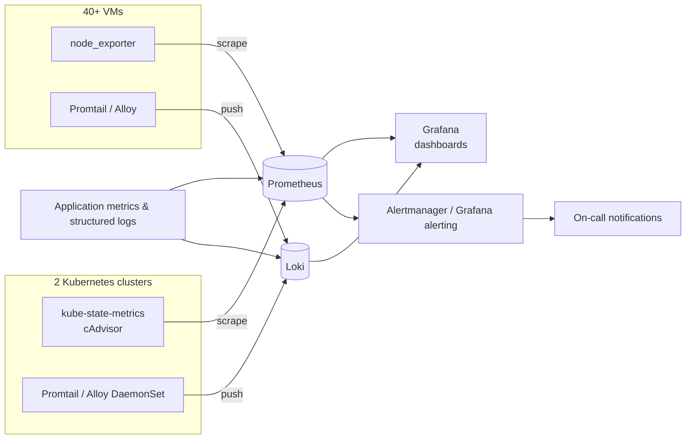

# Centralized Monitoring & Logging

 -lightgrey) 

> **Architecture write-up.** This documents a system I designed and built as a DevOps Engineer at Faclon Labs (Mumbai). The implementation belongs to my employer and is not published; what follows is the design, the moving parts and the outcomes, with internal names and details left out.

Prometheus, Grafana and Loki deployed from scratch across **40+ VMs and 2
Kubernetes clusters**: one place for metrics, one for logs, alerting across
all of it. Manual spot-checking of servers was replaced with infrastructure-
wide visibility.

## The problem

Checking whether something was healthy meant logging into it. Logs lived on
the machine that wrote them. Problems were found by users first.

## Architecture

## What is collected

- **Hosts**: CPU, memory, disk, network and process health from every VM.
- **Kubernetes**: cluster state, pod restarts, resource usage, scheduling.
- **Applications**: service metrics and structured logs from the Python
  microservices, through shared logging and messaging integrations.
- **Logs** from everything above, labelled so a host, a service and a time
  range are one query away.

## Design points

- **Metrics and logs share labels**, so a Grafana panel and its logs line up.
- **Alerts on symptoms, routed to people**: down hosts, failing services,
  saturated disks — with the dashboard link in the alert.
- **Exporters and agents are provisioned with the environment**, not added
  later (see the environment automation write-up).

## Outcomes

- Centralised metrics, dashboards and log aggregation for the whole estate.
- Alerting across infrastructure instead of manual checks.
- The foundation for on-call, incident response and postmortems.

## Stack

Prometheus · Grafana · Loki · Grafana Alloy / Promtail · node_exporter · kube-state-metrics · Alertmanager

## My role

Designed and deployed the stack, built the dashboards and alert rules, and
onboarded the hosts, clusters and services.
